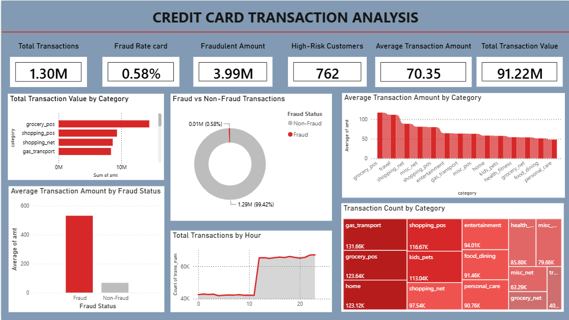

# Credit Card Fraud Analysis

## Project Overview
This project focuses on analyzing credit card transactions to identify fraud patterns and understand transaction behavior using data analytics techniques.

The analysis explores transaction amounts, fraud distribution, merchant categories, customer spending patterns, hourly trends, and geographical patterns.

## Objectives
- Analyze credit card transaction data.
- Identify fraudulent and legitimate transactions.
- Explore fraud trends across merchant categories and transaction hours.
- Understand customer spending behavior.
- Generate meaningful business insights and recommendations.

## Tools and Technologies
- **Python:** Pandas, NumPy, Matplotlib, Seaborn
- **SQL:** MySQL
- **Data Visualization:** Power BI
- **Jupyter Notebook:** Python analysis and documentation

## Project Workflow
1. Data loading and exploration
2. Data cleaning and preprocessing
3. Exploratory Data Analysis (EDA)
4. SQL-based data analysis
5. Data visualization
6. Business insights and report generation
7. Interactive dashboard development using Power BI

## Key Findings
- Total transactions analyzed: 1,296,675
- Fraudulent transactions: 7,506
- Legitimate transactions: 1,289,169
- Fraud percentage: 0.58%
- Average transaction amount: 70.35
- Highest fraud rate observed during late-night hours.
- Shopping and online-related categories showed notable fraud rates.

## Power BI Dashboard

An interactive six-page Power BI dashboard was developed to explore transaction patterns, fraud activity, customer spending, merchant performance, time-based trends, and geographical distribution.

### Dashboard Preview:


### Download Dashboard: 
[Credit Card Fraud Analysis – Power BI (.pbix)](https://github.com/vidishakharode/Credit_Card_Fraud_Analysis/releases/download/v1.0/Credit_Card_Fraud_Analysis.pbix)

## Project Structure
```text
Credit-Card-Fraud-Analysis/
│
├── Python/
│   └── Credit_Card_Fraud_Analysis.ipynb
│
├── SQL/
│   └── Credit_Card_Fraud_Analysis.sql
│
├── Visualizations/
│   ├── 01_transaction_histogram.png
│   ├── 02_fraud_pie_chart.png
│   ├── 03_hourly_transaction_chart.png
│   ├── 04_merchant_category_chart.png
│   ├── 05_transaction_boxplot.png
│   ├── 06_customer_spending_chart.png
│   ├── 07_scatter_plot.png
│   ├── 08_correlation_heatmap.png
│   ├── 09_pair_plot.png
│   └── 10_fraud_count_plot.png
│
└── Reports/
    ├── Credit_Card_Fraud_Report.pdf
    ├── business_insights.txt
    └── statistical_summary.csv
```

## Dataset
Dataset: [Credit Card Fraud Detection – Kaggle](https://www.kaggle.com/datasets/kartik2112/fraud-detection)

The dataset contains transaction details and fraud labels used for analysis.

## Conclusion
This project helped me develop practical experience in data cleaning, exploratory data analysis, SQL querying, visualization, and business insight generation. It demonstrates how data analytics can help understand transaction patterns and support fraud monitoring.

---

**Note:** This project performs analysis on existing fraud labels; it does not include a machine learning prediction model.
